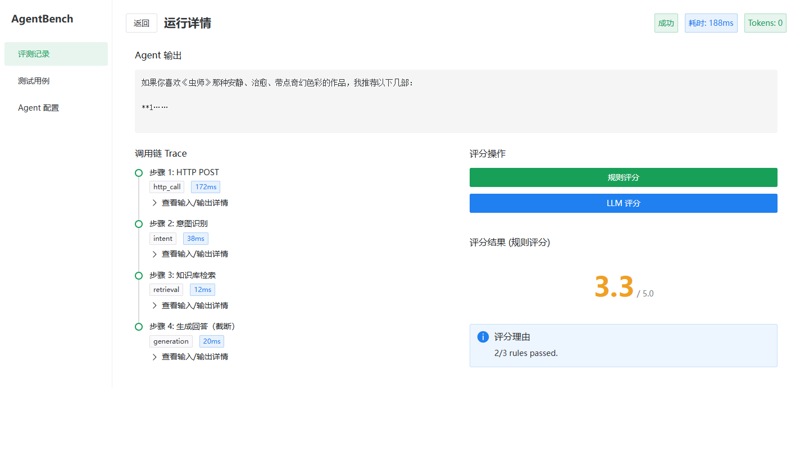
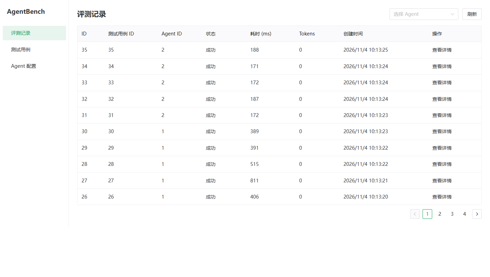
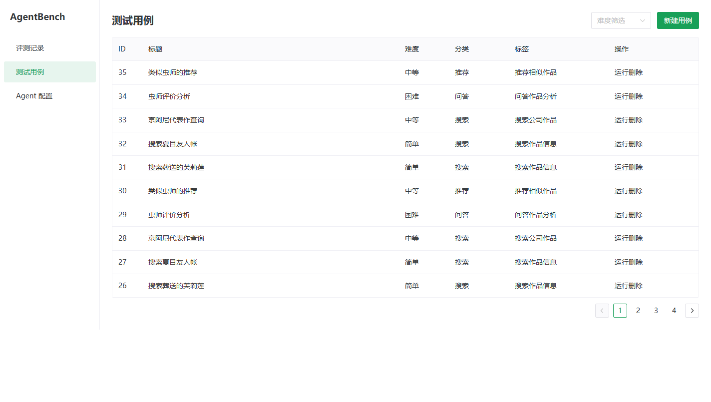
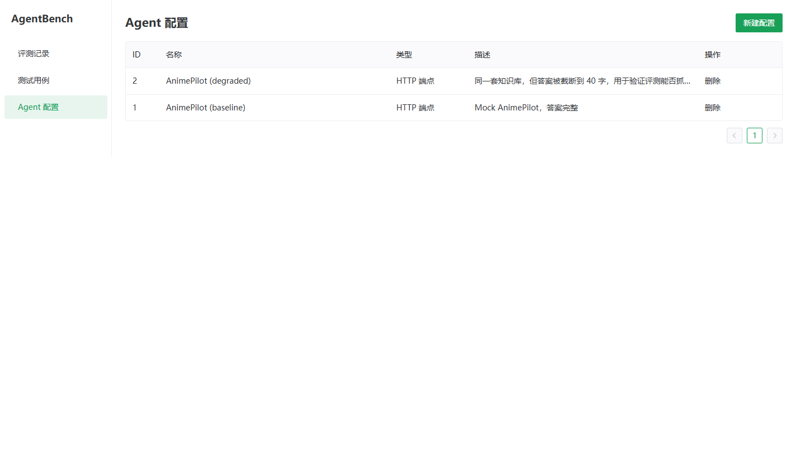

# AgentBench

**给 AI Agent 做回归测试的平台。** 登记一堆测试用例，让任意 Agent 跑一遍，看它答得怎么样、调用链在哪一步崩的、换模型之后分数掉没掉。

大多数人做 Agent 停在「我做了个 RAG」；这个项目回答的是下一个问题：**你怎么知道它好不好？**


---

## 这个项目解决什么

Agent 开发有个绕不开的坑：改一个 prompt、换一个模型、加一个工具，你没法快速知道整体是变好了还是变差了。手工试几句不算数——那只是抽样。

AgentBench 把这套流程固化下来：

```
测试用例  ×  Agent 配置  →  运行  →  收集 Trace  →  自动评分  →  对比
```

核心能力：

| 能力 | 说明 |
|---|---|
| 框架无关 | 4 种 runner 适配器，任何能被 HTTP 调用的 Agent 都能接进来 |
| 调用链可见 | 每次运行记录逐步 Trace（步骤类型、耗时、token、错误） |
| 双轨评分 | 规则打分（快、确定）+ LLM-as-Judge（四维度、能处理开放式答案） |
| 可比 | 同一批用例跑多个 Agent 配置，分数并排看 |

---

## 为什么「只有一个 Agent 拿 5.0 分」证明不了任何事

这是本项目的核心设计动机。

如果只跑一个 Agent、全部满分，那只说明关键词规则匹配上了——平台有没有用、能不能抓出问题，完全没被检验。

所以 `demo/compare_agents.py` 造了个对照组：同一个 mock 知识库、同一批用例，但第二个 Agent 把答案**截断到 40 字**，模拟「模型退化 / 检索漏掉了关键事实」。跑出来的真实结果：

```
#   测试用例                 baseline   degraded       差距
--------------------------------------------------------------------
1   搜索葬送的芙莉莲                  5.0        2.5      2.5
2   搜索夏目友人帐                   5.0        3.8      1.2
3   京阿尼代表作查询                  5.0        1.0      4.0
4   虫师评价分析                    5.0        2.0      3.0
5   类似虫师的推荐                   5.0        3.3      1.7
--------------------------------------------------------------------
    平均分                      5.00       2.52     2.48
```

差距能拉开，才说明评测在干活。这个对比不需要任何 LLM key，离线就能跑。

## 截图

运行详情页——一次运行的四步调用链（`http_call` 接 Agent 本身，加上 Agent 内部报上来的 `intent` / `retrieval` / `generation`），每步都有自己的耗时和输入输出：



| 评测记录 | 测试用例 |
|---|---|
|  |  |



---

## 快速开始

需要 Python 3.11+ 和 Node 20+。

### 1. 后端

```bash
cd backend
pip install -e ".[dev]"
uvicorn app.main:app --port 8090
```

打开 http://127.0.0.1:8090/docs 能看接口文档。数据库是 SQLite，首次启动自动建表，不需要装 PostgreSQL。

### 2. 前端

```bash
cd frontend
npm ci
npm run dev
```

打开 http://localhost:5173 。

### 3. 跑那个 A/B 对比（不需要 key）

开三个终端：

```bash
# 终端 1：后端
cd backend && uvicorn app.main:app --port 8090

# 终端 2：mock Agent（监听 8003）
python demo/mock_animepilot.py

# 终端 3：跑对比
PYTHONIOENCODING=utf-8 python demo/compare_agents.py
```

`PYTHONIOENCODING=utf-8` 是 Windows 上必须的——脚本输出 emoji，GBK 控制台会 `UnicodeEncodeError`。

---

## 架构

```
┌──────────────┐   HTTP/JSON   ┌──────────────────┐
│  Vue 3 SPA   │ ────────────► │   FastAPI        │
│  Pinia       │               │   SQLAlchemy 2.0 │
│  Naive UI    │ ◄──────────── │   async          │
└──────────────┘               └────────┬─────────┘
                                        │
                    ┌───────────────────┼───────────────────┐
                    ▼                   ▼                   ▼
            ┌──────────────┐   ┌──────────────┐   ┌──────────────┐
            │ RunnerService│   │ EvalService  │   │   SQLite     │
            │ 4 个适配器    │   │ 规则 + LLM   │   │  5 张表      │
            └──────┬───────┘   └──────────────┘   └──────────────┘
                   │
       ┌───────────┼───────────┬────────────┐
       ▼           ▼           ▼            ▼
   HTTP        OpenAI兼容   LangGraph   Python函数
```

**为什么用异步 SQLAlchemy：** runner 要调外部 Agent，天然是 IO 密集；同步 session 会在一次运行里长时间占住连接。

**为什么 Trace 单独一张表：** 一次运行的步骤是变长的，塞进 `test_runs` 的 JSON 列就没法按 `step_type` 筛选、也没法算「哪一步最慢」。

---

## 数据模型

五张表，都在 `backend/app/models/`：

| 表 | 作用 | 关键字段 |
|---|---|---|
| `test_cases` | 测试用例 | `input_text` / `expected_behavior` / `scoring_criteria` / `difficulty` |
| `agent_configs` | 被测 Agent 的接入配置 | `agent_type` / `config`（JSON 文本） |
| `test_runs` | 一次「用例 × Agent」的执行 | `status` / `agent_output` / `duration_ms` / `total_tokens` |
| `run_steps` | 运行中的每一步 | `sequence` / `step_type` / `latency_ms` / `token_usage_input` |
| `evaluation_results` | 评分结果 | `judge_type` / `overall_score` / 四维度分 / `rule_results` |

`agent_type` 是枚举：`http` / `openai_compatible` / `langgraph` / `python_fn`。

---

## 四种 Runner

所有 Runner 继承 `app/runners/base.py` 的 `AgentRunner`，实现一个 `run(test_input) -> RunResult`，把过程写进 `TraceCollector`。

### `http` —— 接任意 HTTP Agent

```json
{
  "endpoint": "http://127.0.0.1:8003/api/agent/chat",
  "method": "POST",
  "headers": {"Authorization": "Bearer xxx"},
  "timeout": 30,
  "request_body_template": {"content": "{input}"},
  "output_field": "answer",
  "trace_field": "trace"
}
```

`request_body_template` 里用 `{input}` 占位；`output_field` 和 `trace_field` 支持点号路径（如 `data.output`）。

### `openai_compatible` —— 直接测某个模型

```json
{
  "endpoint": "https://api.deepseek.com/v1/chat/completions",
  "model": "deepseek-chat",
  "api_key": "sk-xxx"
}
```

换 `endpoint` 就能测 DeepSeek / 通义 / 智谱，不用改代码。

### `langgraph` —— 跑编译好的图

```json
{"graph": "<编译后的 CompiledGraph 对象>"}
```

注意这个配置只能通过 Python 代码传（JSON 里存不了对象），所以适合在测试或脚本里直接构造。

### `python_fn` —— 直接调你自己的函数

```json
{"function": "<async def f(input) -> str>"}
```

函数可以有 `step_collector` 参数，配合 `@trace_step` 装饰器把内部步骤记进 trace：

```python
from app.runners.python_fn_adapter import trace_step

@trace_step(step_type="retrieval", name="向量检索")
async def retrieve(query: str) -> list[str]:
    ...
```

### 写自己的 Runner

```python
from app.runners.base import AgentRunner, RunResult

class MyRunner(AgentRunner):
    async def run(self, test_input: str) -> RunResult:
        from app.utils.trace_collector import TraceCollector
        collector = TraceCollector()

        with collector.step(step_type="my_step", name="调用我的 Agent"):
            output = await do_something(test_input)

        return RunResult(output=output, collector=collector)
```

然后在 `app/services/runner_service.py` 的 `ADAPTER_MAP` 里注册。记得同步改 `app/schemas/agent_config.py` 里的 `agent_type` 正则。

---

## 两种评分

### 规则评分（`RuleEvaluator`）

三种规则，全部通过才 5.0，否则按比例给分（最低 1.0）：

| type | 含义 |
|---|---|
| `keyword_contains` | 输出必须包含某关键词 |
| `keyword_not_contains` | 输出必须**不**包含某关键词（抓幻觉、抓禁忌回答） |
| `regex_match` | 正则匹配 |

快、确定、不花钱。适合「答案里必须有这些事实」的场景。

### LLM-as-Judge（`LLMJudgeEvaluator`）

四个维度各 1-5 分，取平均：

| 维度 | 评什么 |
|---|---|
| `accuracy` | 是否准确回答了问题 |
| `hallucination` | 有无编造（5 = 无幻觉） |
| `tool_correctness` | 工具调用的参数和时机对不对（无工具调用给 3） |
| `expression_quality` | 中文表达质量 |

需要配 LLM，在 `backend/.env`：

```
AGENTBENCH_LLM_BASE_URL=https://api.deepseek.com/v1
AGENTBENCH_LLM_API_KEY=sk-xxx
AGENTBENCH_LLM_MODEL=deepseek-chat
AGENTBENCH_LLM_JUDGE_MODEL=deepseek-chat
```

解析做了三层兜底：直接 `json.loads` → 剥 ```json 代码块 → 正则抓第一个 `{...}`。全失败时返回 0 分并把原始响应前 200 字放进 reasoning，方便排查。

---

## API

17 个端点，都挂在 `/api`：

```
POST   /api/agent-configs/           创建 Agent 配置
GET    /api/agent-configs/           列表（分页）
GET    /api/agent-configs/{id}       详情
PUT    /api/agent-configs/{id}       更新
DELETE /api/agent-configs/{id}       删除

POST   /api/test-cases/              创建用例
GET    /api/test-cases/              列表（按 difficulty/category/tag 筛选）
GET    /api/test-cases/{id}          详情
PUT    /api/test-cases/{id}          更新
DELETE /api/test-cases/{id}          删除

POST   /api/test-runs/               跑一次（query: test_case_id, agent_config_id）
GET    /api/test-runs/               列表
GET    /api/test-runs/{id}           详情
GET    /api/test-runs/{id}/steps     调用链

POST   /api/evaluations/             评分（body: test_run_id, rules, use_llm_judge）
GET    /api/evaluations/{id}         评分详情
GET    /api/evaluations/run/{run_id} 某次运行的全部评分
```

---

## 前端

6 个页面，Vue 3 + TypeScript + Naive UI + Pinia：

| 路由 | 页面 |
|---|---|
| `/test-cases` | 用例列表 |
| `/test-cases/new` | 新建用例 |
| `/agent-configs` | Agent 配置列表 |
| `/agent-configs/new` | 新建配置 |
| `/test-runs` | 运行列表 |
| `/run/:id` | 运行详情（Trace 时间线 + 评分卡） |

`TraceTimeline` 和 `ScoreCard` 是本项目视觉上最有辨识度的两个组件：前者把每一步的耗时画成横条，后者把四个维度的分数画成雷达。

---

## 测试

```bash
cd backend && pytest -q          # 60 passed
cd frontend && npm test          # 8 passed
cd frontend && npm run build     # vue-tsc + vite build
```

分布：

| 目录 | 数量 | 覆盖 |
|---|---|---|
| `tests/unit/runners/` | 4 个文件 | 四种适配器的成功/失败/超时路径 |
| `tests/unit/evaluators/` | 2 个文件 | 规则打分边界、LLM 响应三层解析兜底 |
| `tests/unit/services/` | 4 个文件 | 用例 CRUD、配置 CRUD、运行编排、评分流程 |
| `tests/unit/utils/` | 1 个文件 | TraceCollector 的序列号、token 累加、耗时 |
| `tests/integration/` | 3 个文件 | 三个路由组的端到端 |
| `frontend/src/components/__tests__/` | 2 个文件 | TraceTimeline、ScoreCard 渲染 |

---

## 已知边界

说清楚不做什么，比声称什么都能做更有用：

- **单用户，无鉴权。** 没有登录注册，接口谁都能调。设计文档的 YAGNI 一节写明这是 MVP 取舍。
- **串行执行。** 一次只跑一个用例，没有并发压测，没有任务队列。
- **没有版本对比 UI。** 数据模型支持同一用例跑多个配置（`test_runs` 里能存在多行），但前端目前只展示单次运行，没有「A 配置 vs B 配置」的并排页面。
- **没有 CI 集成。** 不能作为 GitHub Action 在 PR 上自动跑评测。
- **`langgraph` 和 `python_fn` 两种 runner 只能从代码里用。** 它们的 config 需要传 Python 对象，JSON 存不下，所以前端「新建 Agent 配置」页面对这两种类型实际上用不了。
- **LLM Judge 的可靠性没有校准。** 没有人工标注集，没有和人类评分的一致性（Cohen's kappa）测量。这是已知的、也是最值得补的一块。
- **SQLite。** 没有迁移（无 Alembic），表结构靠 `create_all`。
- **中文界面。** 无 i18n。

---

## 目录结构

```
agentbench/
├── backend/
│   ├── app/
│   │   ├── evaluators/      规则评分、LLM Judge
│   │   ├── models/          5 张表的 SQLAlchemy 模型
│   │   ├── routers/         4 组 API
│   │   ├── runners/         4 种执行适配器
│   │   ├── schemas/         Pydantic 请求/响应
│   │   ├── services/        业务编排
│   │   └── utils/           TraceCollector
│   └── tests/               60 个测试
├── frontend/
│   └── src/
│       ├── api/             接口封装
│       ├── components/      TraceTimeline、ScoreCard
│       ├── stores/          Pinia
│       └── views/           6 个页面
├── demo/
│   ├── mock_animepilot.py   假 Agent，离线可跑
│   ├── benchmark_animepilot.py  单 Agent 跑一遍
│   └── compare_agents.py    A/B 对比（核心演示）
└── docs/superpowers/        设计文档与实现计划
```

规模：后端 1384 行、测试 886 行、前端 1432 行。

---

## English

**AgentBench is a regression-testing platform for AI agents.** Register test cases, run any agent against them, inspect the execution trace step by step, and score the results — either with deterministic keyword/regex rules or with an LLM-as-Judge across four dimensions (accuracy, hallucination, tool correctness, expression quality).

The point is comparison. A single agent scoring 5.0 proves nothing; `demo/compare_agents.py` ships a deliberately degraded agent so you can see the platform actually separate 5.00 from 2.52 on the same test set.

Runs entirely on SQLite, needs no Docker, and the demo works offline with no API key.

MIT licensed.
